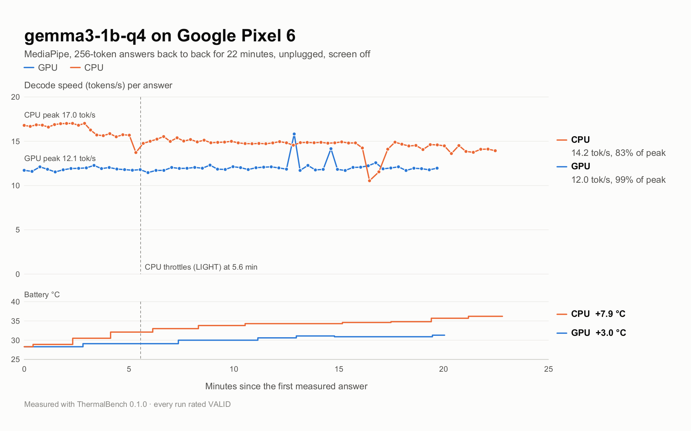

<div align="center">

# ThermalBench

**How fast does your phone run AI after 20 minutes, not after 20 seconds?**

An Android benchmark that runs a language model on-device under sustained load
and measures how much of its peak speed the phone actually keeps.




</div>

### What it measures

- **Retention ratio:** steady-state speed ÷ peak speed, one number for how well
  a phone holds up once it is hot.
- **When and how hard the phone throttles:** Android thermal status, clocks and
  temperatures, recorded alongside every iteration.
- **CPU vs GPU vs NPU:** the same model and prompt on every compute unit,
  side by side, across LiteRT-LM, llama.cpp, MediaPipe and Qualcomm Genie.
- **Shareable output:** a PDF report and a chart image per run.

### Documentation

Everything else, from installing and running a benchmark to reading the results
and the measurement method, is in the two PDFs:

- **[ThermalBench Guide](DOCS/ThermalBench-Guide.pdf):** a plain-language guide
  to what the tool measures, how to run it and how to read the results.
- **[Developer Manual](DOCS/ThermalBench-Developer-Manual.pdf):** the rationale,
  the measurement method, the architecture, and how to operate every part of
  the tool.

Both are built from `DOCS/guide_content.py` and `DOCS/manual_content.py`
(needs `reportlab`):

```
python DOCS/build_manual.py
THERMALBENCH_CONTENT=guide_content python DOCS/build_manual.py
```

### Licence

Copyright (c) 2026 uwechue-o. All rights reserved; see [LICENSE](LICENSE).
Third-party components keep their own licences, listed on the app's licences
screen.
